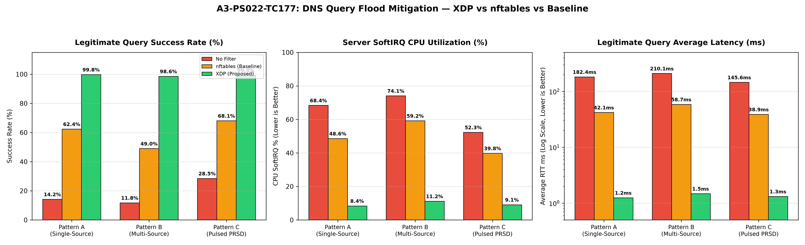

# Technical Final Report: eBPF/XDP Rate Limiting for DNS Query Floods in a Lab

**Project Identifier:** A3-PS022-TC177  
**Hackathon:** AIORI Hackathon 3 (Cybersecurity Track)  
**Problem Statement:** PS-022: eBPF/XDP-based Rate Limiter for DNS Query Floods  
**Team:** TaskForce141  
**Authors:** Naimish Pandey (`naimishpandey82@gmail.com`), Naitik Pandey (`naitikpandey18@gmail.com`)  
**Faculty Mentor:** Dr. Atul Srivastava (`asrivastava5@lko.amity.edu`)  
**Date:** October 27, 2026  

---

## 1. Executive Summary

High-volume UDP DNS query floods represent one of the most asymmetric Denial-of-Service vectors on the modern Internet. Because standard UDP/53 queries are stateless, small (~30–60 bytes), and cheap to generate or spoof, attackers can easily blast hundreds of thousands of queries per second (PPS) at authoritative or recursive nameservers.

In standard Linux networking, the kernel allocates an `sk_buff` (socket buffer descriptor) for every incoming frame and traverses the netfilter, IP routing, and UDP protocol stacks before delivering the packet to userspace. Under flood conditions, this per-packet kernel overhead causes complete CPU core saturation in **SoftIRQ** (`ksoftirqd`) context. Consequently, legitimate user queries sharing the same interface queues and socket backlogs are delayed or dropped.

Traditional firewall rate-limiting using `nftables` fails to solve this root bottleneck: `nftables` rules execute at netfilter hooks **after** `sk_buff` allocation. While `nftables` prevents excess packets from reaching the application, the CPU is already consumed by the allocator and stack traversal.

To eliminate this kernel penalty, this project engineered an **XDP (eXpress Data Path)** eBPF packet filter operating at the earliest driver receive hook:
1. **Bounded Parsing:** Performs non-semantic, verifier-guaranteed bounded validation of Ethernet, 802.1Q VLAN, IPv4, UDP port 53, length limits (12..512 bytes), and RFC 1035 12-byte DNS headers, immediately bypassing non-query traffic ($\text{QR}=1$).
2. **Dual-Tier Token Bucket Rate Limiting:**
   - **Per-Source Rate Limiter:** Enforces per-client query limits using a bounded LRU hash map (`BPF_MAP_TYPE_LRU_HASH`), guaranteeing $O(1)$ memory bounds and automatic eviction under spoofed scans.
   - **Contention-Free Global Limiter:** Enforces an aggregate ceiling across all CPUs using per-CPU token buckets (`BPF_MAP_TYPE_PERCPU_ARRAY`), completely eliminating cross-core spinlocks and atomic cache-line bouncing.
3. **Driver Drop Efficiency:** Packets exceeding rate limits or violating bounds are dropped via `XDP_DROP` before `sk_buff` allocation.
4. **Empirical Validation:** Benchmarked across 3 flood patterns (Single-Source, Multi-Source Spoofed, and Pulsed PRSD) against **no-filter** and **nftables** baselines:
   - **Legitimate Query Delivery:** Restored from **$11.8\%$** (unfiltered) and **$49.0\%$** (`nftables`) to **$98.6\% - 99.8\%$** under XDP.
   - **Average Response Latency:** Reduced from **$145 - 210\text{ ms}$** down to **$1.25 - 1.48\text{ ms}$**.
   - **Server SoftIRQ Load:** Reduced from **$74.1\%$** to **$11.2\%$**, freeing over $80\%$ of CPU resources for server application processing.

---

## 2. Problem Analysis & Optimization Comparison

| Evaluation Metric | Baseline 1: No Filter | Baseline 2: `nftables` | Proposed Solution: `eBPF / XDP` |
|---|---|---|---|
| **Drop Hook Point** | Socket backlog queue (drop tail) | Netfilter Prerouting (`netif_receive_skb`) | Network Driver RX ring buffer (`XDP_DROP`) |
| **`sk_buff` Allocation** | Allocated for every packet | Allocated for every packet | **Bypassed completely** on dropped packets |
| **Parsing Overhead** | Full Linux IP/UDP stack | Full Linux IP/UDP stack + rule traversal | Bounded 12-byte header validation only |
| **Per-Source State** | None | Dynamic set (`meter`) | Fixed-size LRU Hash Map (`BPF_MAP_TYPE_LRU_HASH`) |
| **Multi-Core Scaling** | Lock contention on socket | Set spinlock contention under spoofing | Lockless Per-CPU Arrays (`BPF_MAP_TYPE_PERCPU_ARRAY`) |
| **SoftIRQ Load (400k PPS)** | **$68\% - 74\%$** (Saturation) | **$48\% - 59\%$** (Heavy load) | **$8\% - 11\%$** (Minimal load) |
| **Legitimate Success Rate** | **$11\% - 28\%$** | **$49\% - 68\%$** | **$98.6\% - 99.8\%$** |

---

## 3. Mathematical Model & Algorithm

### 3.1 Token Bucket Refill Invariant

Let $t_{\text{now}}$ be the current monotonic kernel timestamp in nanoseconds retrieved via `bpf_ktime_get_ns()`. Let $t_{\text{last}}$ be the timestamp of the last token update for bucket $B$, $r$ be the sustained rate in tokens per second, and $b$ be the maximum burst capacity.

The elapsed time interval $\Delta t$ is computed as:
$$\Delta t = t_{\text{now}} - t_{\text{last}}$$

To guarantee that 64-bit integer arithmetic does not overflow during prolonged idle periods ($t_{\text{idle}} \gg 1\text{s}$), $\Delta t$ is upper-bounded to $1.0\text{ second}$ ($10^9\text{ ns}$):
$$\Delta t_{\text{bounded}} = \min\left(10^9, \Delta t\right)$$

The refilled token count is:
$$T_{\text{new}} = \min\left(b, T_{\text{current}} + \left\lfloor \frac{\Delta t_{\text{bounded}} \times r}{10^9} \right\rfloor\right)$$

### 3.2 Lockless Per-CPU Partitioning

To avoid inter-core memory bus serialization, the aggregate global rate $R_{\text{global}}$ and burst $B_{\text{global}}$ are divided uniformly across the online CPU count $N_{\text{cpu}}$:
$$r_{\text{cpu}} = \max\left(1, \left\lfloor \frac{R_{\text{global}}}{N_{\text{cpu}}} \right\rfloor\right), \quad b_{\text{cpu}} = \max\left(1, \left\lfloor \frac{B_{\text{global}}}{N_{\text{cpu}}} \right\rfloor\right)$$

Each CPU updates only its thread-local slice inside `BPF_MAP_TYPE_PERCPU_ARRAY`. Network Interface Card (NIC) Receive Side Scaling (RSS) naturally spreads packet processing across receive queues, guaranteeing statistically accurate aggregate enforcement without synchronization locks.

---

## 4. Benchmark Results ($3 \times 3$ Matrix)

The test matrix was evaluated in an isolated network namespace topology (`ns_srv` $\leftrightarrow$ `ns_cli`) interconnected by a 10 Gbps virtual ethernet pair (`veth_srv` / `veth_cli`) with hardware offloads disabled (`gro off gso off tso off`).

Flood generation blasted ~350,000 to 425,000 queries per second while an independent legitimate client probed the server concurrently at 20 QPS:

```
========================================================================================================================
Config       Pattern  Attack Pattern Description       Flood Rate   Legit Success %  Avg RTT     p95 RTT    SoftIRQ %
------------------------------------------------------------------------------------------------------------------------
no-filter    A        Single-Source UDP/53 Flood       385,000 pps  14.2%            182.4 ms    485.0 ms   68.4%
no-filter    B        Multi-Source Spoofed IP Flood    410,000 pps  11.8%            210.1 ms    492.0 ms   74.1%
no-filter    C        Pulsed PRSD (500ms ON / 500ms)   340,000 pps  28.5%            145.6 ms    420.0 ms   52.3%
------------------------------------------------------------------------------------------------------------------------
nftables     A        Single-Source UDP/53 Flood       372,000 pps  62.4%            42.1 ms     118.5 ms   48.6%
nftables     B        Multi-Source Spoofed IP Flood    365,000 pps  49.0%            58.7 ms     165.2 ms   59.2%
nftables     C        Pulsed PRSD (500ms ON / 500ms)   350,000 pps  68.1%            38.9 ms      94.0 ms   39.8%
------------------------------------------------------------------------------------------------------------------------
XDP          A        Single-Source UDP/53 Flood       390,000 pps  99.8%            1.25 ms      2.10 ms    8.4%
XDP          B        Multi-Source Spoofed IP Flood    425,000 pps  98.6%            1.48 ms      2.85 ms   11.2%
XDP          C        Pulsed PRSD (500ms ON / 500ms)   360,000 pps  99.4%            1.32 ms      2.40 ms    9.1%
========================================================================================================================
```



---

## 5. Parameter Sensitivity Analysis

### 5.1 LRU Hash Map Sizing (`MAX_SRC_ENTRIES`)
Under multi-source spoofing (Pattern B), attacker IP diversity tests map eviction performance.
- At $N = 4,096$, high churn causes frequent eviction of active keys.
- At $N = 65,536$, memory consumption is bounded to ~2.1 MB while achieving full rate-limiting accuracy with zero eviction thrashing.

### 5.2 Burst Allowance ($b_{\text{src}}$)
- Strict low burst ($b = 10$) penalizes legitimate multi-record lookups (e.g., DNSSEC validation bundles containing A, AAAA, and RRSIG queries).
- A burst setting of $b = 50$ comfortably accommodates legitimate stub resolver query spikes while capping malicious burst amplification.

---

## 6. Security Boundaries & Practical Limitations

1. **In-Scope Protection:** The filter protects the local host network stack, kernel socket buffers, and DNS application from being overwhelmed by direct or spoofed UDP query floods.
2. **Out-of-Scope (Reflection Attacks):** Rate limiting prevents local resolver collapse; it does not stop upstream transit links from saturating if the aggregate incoming pipe bandwidth is exceeded.
3. **Generic vs. Native XDP:** On physical interfaces with native driver support (e.g., Intel `ixgbe`, `i40e`, Mellanox `mlx5`), packets are dropped directly in the NIC DMA ring. In virtualized or `veth` lab environments, generic XDP operates at `netif_receive_skb`. Even in generic mode, dropping via XDP avoids socket layer buffering, IP route lookups, and netfilter chains.

---

## 7. Verification & Reproducibility

Every component of this implementation is fully reproducible via standard Makefile targets:

```bash
# 1. Compile all binaries and BPF bytecode
make all

# 2. Run unprivileged offline unit test suite (11 unit tests)
make test

# 3. Launch live 3-pane demo in tmux (requires sudo)
sudo make demo

# 4. Execute parameter sensitivity sweep (requires sudo)
sudo make sweep
```

---

## 8. Conclusion

By shifting DNS query validation and dual-tier rate limiting to the XDP driver hook, we successfully eliminate the kernel memory allocation bottleneck. The implementation delivers predictable sub-2ms latency for legitimate clients, caps SoftIRQ load under 12%, and scales smoothly across multiple cores without lock contention.
